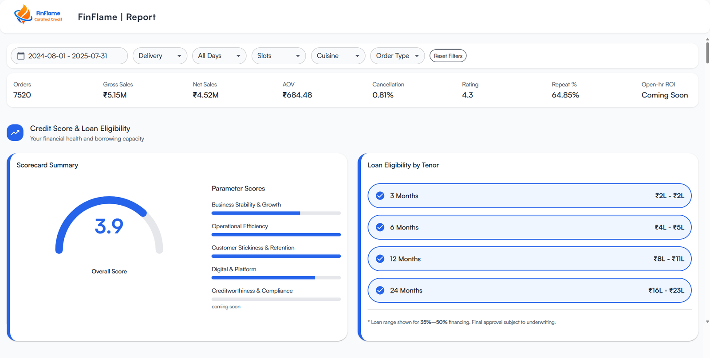
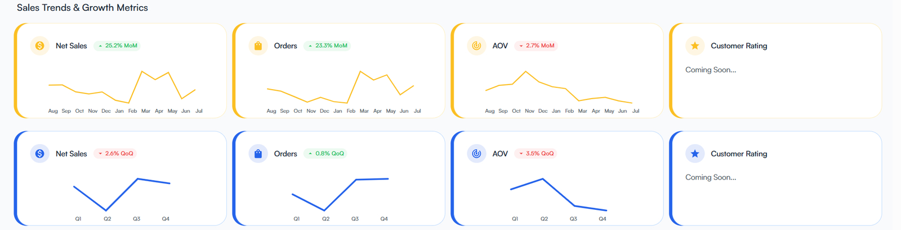
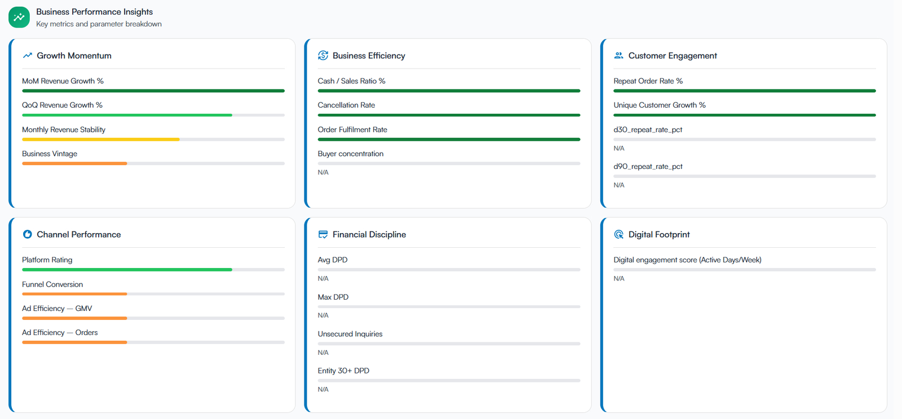
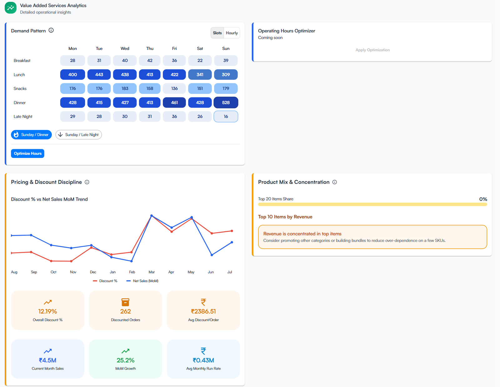
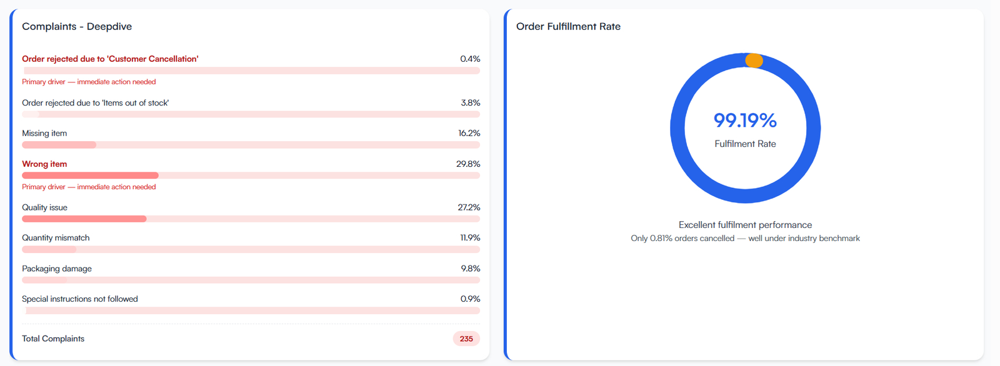
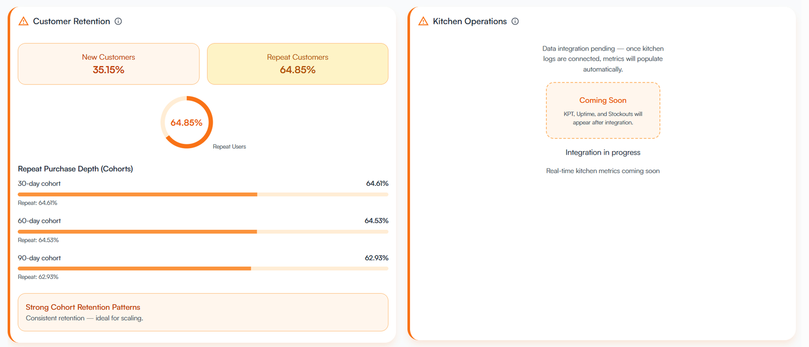
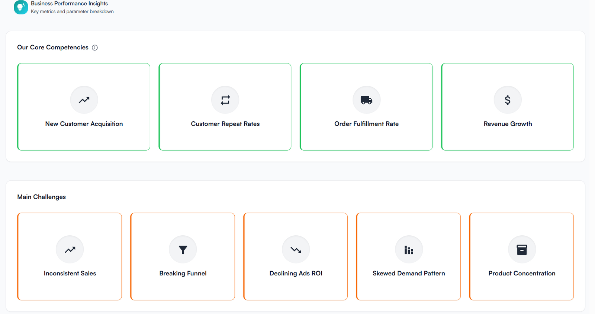
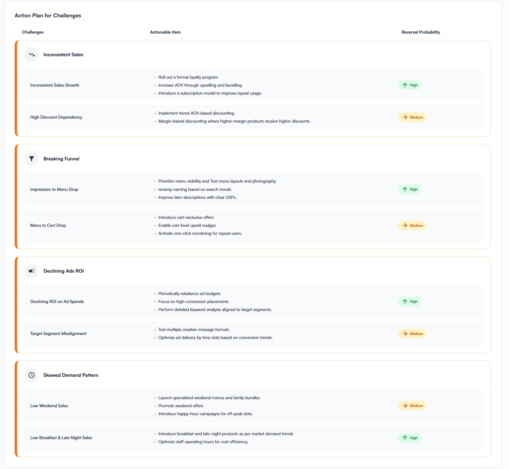
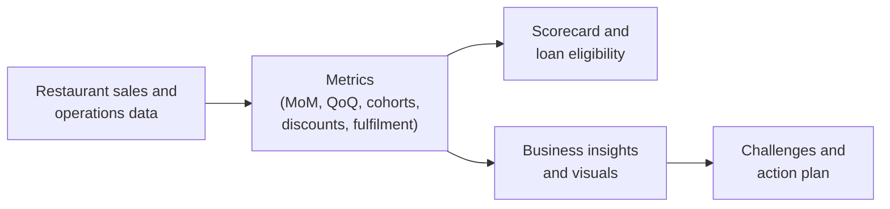

# FinFlame: Restaurant Credit Intelligence

**An AI-driven credit evaluation and business intelligence report for restaurants that sell on food delivery platforms.**

> **Documentation only.** This repository describes a product I worked on as an intern. It contains screenshots with sample data and my notes. It does not contain source code, real data or internal company files. See [Disclosure](#disclosure).

*The top of the FinFlame report, shown with sample data.*

## At a glance

| | |
|---|---|
| **Product** | FinFlame ("Curated Credit"), a restaurant credit and business health report |
| **Built at** | Softsensor.ai |
| **My role** | Data Science and Consulting Intern, Nov 2025 to Jan 2026 |
| **Users** | Restaurant owners and operators (food-service MSMEs selling on Swiggy and Zomato) |
| **Stage** | Beta. The report's own disclaimer says its insights are indicative |
| **Screenshots** | Captured on 23 Dec 2025 from a local build, using sample data |

## Contents

1. [The idea](#the-idea)
2. [What the report shows](#what-the-report-shows)
3. [How it works](#how-it-works)
4. [My contribution](#my-contribution)
5. [Design principles in the product](#design-principles-in-the-product)
6. [What was still coming](#what-was-still-coming)
7. [Disclosure](#disclosure)

## The idea

Restaurants that sell through delivery apps already produce a detailed record of their business: orders, sales, discounts, ratings, cancellations and repeat customers. That record is hard for an owner to read and hard for a lender to use.

FinFlame turns this data into two things:

- **A credit view:** a scorecard with parameter scores and indicative loan ranges by tenor.
- **A business health view:** metrics grouped by theme, the restaurant's strengths and challenges, and a prioritised action plan.

## What the report shows

### 1. Credit score and loan eligibility

- **Filters:** date range, channel, days, time slots, cuisine and order type, with a one-click reset.
- **Headline numbers:** orders, gross sales, net sales, average order value, cancellation rate, rating and repeat customer share.
- **Scorecard:** an overall score built from five parameters: Business Stability and Growth, Operational Efficiency, Customer Stickiness and Retention, Digital and Platform, and Creditworthiness and Compliance (shown as coming soon).
- **Loan eligibility by tenor:** indicative ranges for 3, 6, 12 and 24 months. A footnote states that final approval is subject to underwriting.

### 2. Sales trends

Net sales, orders and average order value, each shown month on month and quarter on quarter, with a change badge that turns red or green. A customer rating trend is marked as coming soon.

### 3. Business performance insights

Six groups of metrics, each drawn as a colour-coded bar: Growth Momentum, Business Efficiency, Customer Engagement, Channel Performance, Financial Discipline and Digital Footprint. When a metric has no data yet, the report shows **N/A** instead of a guess.

### 4. Demand, pricing and product mix

- **Demand pattern:** a heatmap of orders by day and meal slot (breakfast, lunch, snacks, dinner, late night), with a toggle for hourly view and callouts for the busiest and quietest slots.
- **Pricing and discount discipline:** discount percentage against net sales over time, plus tiles for overall discount, discounted orders, average discount per order, current month sales, growth and run rate.
- **Product mix and concentration:** the top ten items by revenue, with a warning when revenue depends on a few items.

### 5. Complaints and fulfilment

A breakdown of complaints by reason, with the main drivers flagged for action, next to the order fulfilment rate.

### 6. Customer retention and kitchen operations

New against repeat customers, and repeat purchase depth for 30, 60 and 90 day cohorts. The kitchen operations panel is a placeholder until kitchen data is connected.

### 7. Strengths and challenges

The report names the restaurant's strengths (for example new customer acquisition and order fulfilment) and its main challenges (for example a breaking funnel and declining ad returns) in one glance.

### 8. Action plan

Each challenge is split into specific problems. Each problem gets a short list of actions and a **reversal probability** tag (High or Medium), so the owner can see where effort is most likely to pay off.

## How it works

A simplified view of the flow. The scoring logic and the AI engine are proprietary and are not described here.

## My contribution

I joined as a Data Science and Consulting Intern and worked end to end on development, strategy and improving the core product.

- **Frontend:** built the report interface end to end.
- **Backend logic:** wrote the month-on-month and quarter-on-quarter calculations and the logic that maps scores to visuals.
- **Recommendation engine:** built a data-conditional engine that chooses which recommendations to show based on the restaurant's data.
- **Discovery:** spoke directly with restaurants to understand their problems, and reached out to partners including PetPooja, Zomato and Swiggy.
- **Customers and RFPs:** worked on RFPs and customer conversations.

## Design principles in the product

- **Show what is missing.** Where data is not yet connected, the report says "N/A" or "Coming soon" instead of showing a made-up number.
- **Be clear about confidence.** Loan ranges are indicative and subject to underwriting, and the report carries a beta disclaimer.
- **Pair every problem with an action.** Challenges lead to concrete steps, ranked by how likely they are to work.
- **Use colour for status.** Green marks strengths, orange marks challenges and red marks complaints that need attention.
- **Let the owner slice the data.** Filters for date, channel, day, slot, cuisine and order type apply across the report.

## What was still coming

The report marked these as in progress when the screenshots were taken:

- Customer rating trend
- Creditworthiness and Compliance score
- Open-hour ROI and the Operating Hours Optimizer
- Kitchen operations metrics (preparation time, uptime and stockouts)
- Action Playbook with real-time metrics
- Financial discipline and digital footprint metrics that need external data

## Disclosure

This repository is documentation only. The product, its source code, datasets, scoring logic, partner materials and internal documents belong to the company and are not included here.

- Screenshots show **sample data** from a local build captured on 23 December 2025. They may differ from the live product.
- Figures are illustrative. Nothing here is financial advice or a lending offer.
- The FinFlame name and logo belong to their owners.

---

**Author:** Ayush Gupta · MBA, IIT Kanpur · [GitHub](https://github.com/ayushgupta8927)
